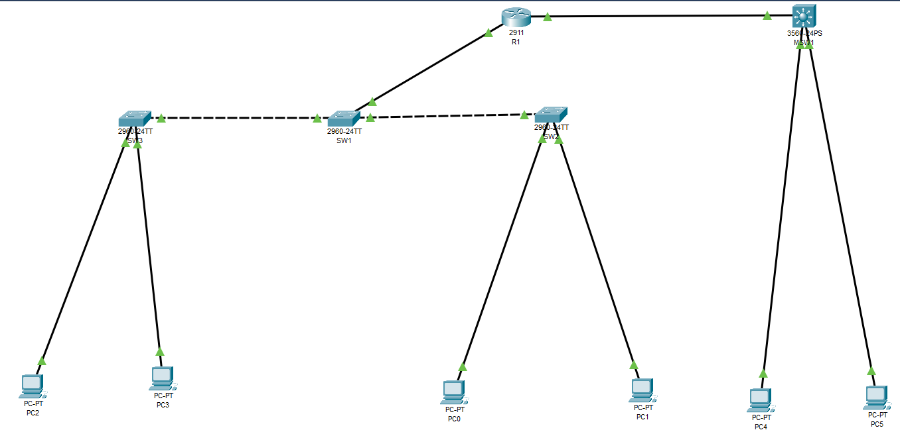
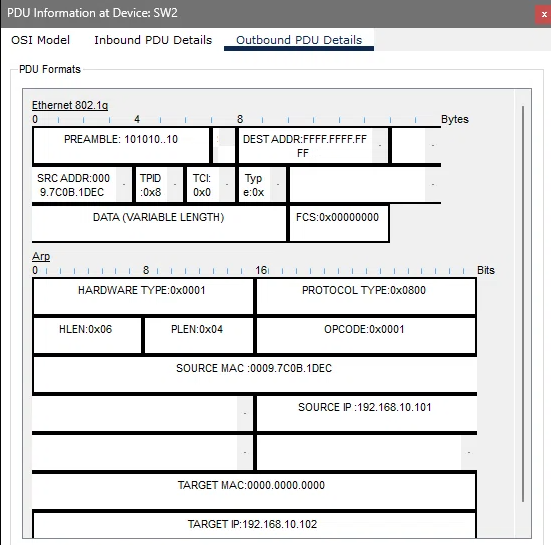
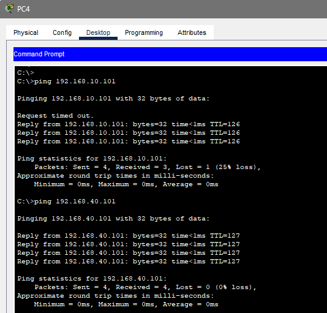
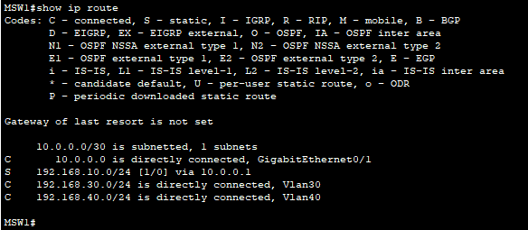
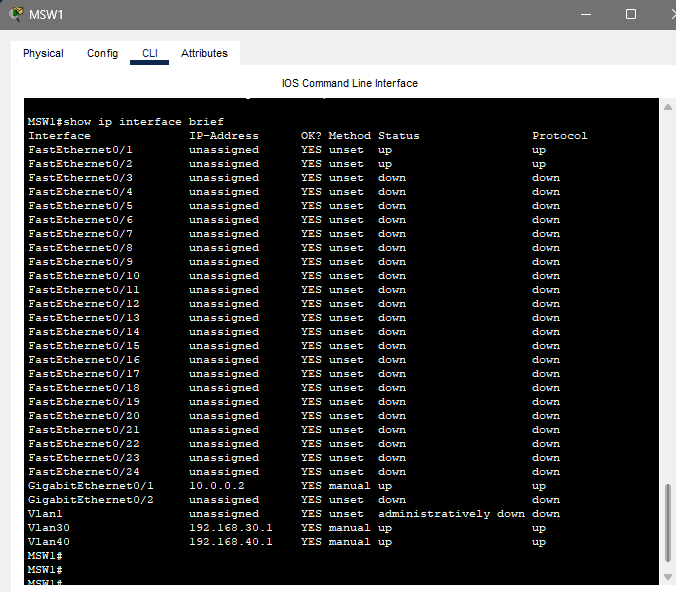

# Отчет по лабораторной работе 3
**Тема:** VLAN, маршрутизация между VLAN  
**Выполнил:** Пьянов Никита 439 группа  
**Специальность:** 09.02.06 «Сетевое и системное администрирование»  

---

## Топология

---

## Часть 1: Создание топологии и начальная конфигурация устройств

### Шаг 1
Собрана топология согласно заданию. На всех устройствах выполнена базовая настройка: задан hostname, отключен поиск DNS (`no ip domain-lookup`), на консольном интерфейсе включена синхронизация вывода (`logging synchronous`).

### Шаг 2
На ПК PC0–PC5 настроены статические IP-адреса, маски и шлюзы в соответствии с таблицей адресации.

---

## Часть 2: Базовая конфигурация VLAN

### Шаг 1: Создание VLAN, настройка портов доступа
На коммутаторах SW1, SW2, SW3 созданы VLAN 10 (STUDENTS), 20 (TEACHERS) и 99 (NATIVE). На SW2 и SW3 порты Fa0/1 и Fa0/2 переведены в режим access и назначены в соответствующие VLAN.

### Шаг 2: Настройка статического магистрального интерфейса
На всех коммутаторах настроены транковые интерфейсы. Отключен DTP (`switchport nonegotiate`), разрешены VLAN 10,20, назначен native VLAN 99.

### Шаг 3: Отключение неиспользуемых интерфейсов
Все свободные порты на коммутаторах административно отключены (`shutdown`) с помощью команды `interface range`.

### 📌 Вопрос 1
**Приведите вывод команды `show vlan brief` на SW2. Какие VLAN есть на коммутаторе?**
На коммутаторе SW2 созданы и активны VLAN 1 (default), VLAN 10 (STUDENTS), VLAN 20 (TEACHERS), VLAN 99 (NATIVE), а также системные VLAN 1002-1005.
*(Вставь скриншот `show vlan brief`)*

**Приведите вывод команды `show vlan id 10` на SW2. Какие интерфейсы находятся в VLAN 10?**
В VLAN 10 находится только интерфейс **Fa0/1** (порт доступа для PC0).
*(Вставь скриншот `show vlan id 10`)*

**Приведите вывод команды `show interfaces trunk` на SW1.**
*(Вставь скриншот `show interfaces trunk`)*

### Шаг 4: Проверка связности между узлами в одном VLAN, метка 802.1q
Запущен ping с PC0 до PC2, связность есть. В режиме симуляции с фильтром ARP изучено прохождение кадра через SW2.

### 📌 Вопрос 2
**Изучите заголовок Ethernet кадра в Inbound и Outbound PDU Details. Чем они отличаются?**
В **Inbound PDU Details** Ethernet-заголовок не содержит тега. В **Outbound PDU Details** появляется дополнительное поле **802.1q tag**. Оно вставляется между полями `SRC MAC` и `Type`, так как кадр передается через магистральный интерфейс (trunk) и должен быть помечен идентификатором VLAN.

**Приложите скриншот заголовка Ethernet из Outbound PDU Details, обведите на нём 802.1q tag.**

**Чему равно значение поля TCI? Переведите его из шестнадцатеричной системы (HEX) в десятичную (DEC).**
Значение поля TCI для VLAN 10 равно **0x000A**. В десятичной системе это **10**.

### 📌 Вопрос 3
**В каких VLAN находятся PC0 и PC1. Почему SW2 не отправил ARP Request в сторону PC1?**
PC0 находится в **VLAN 10**, а PC1 — в **VLAN 20**. Коммутатор SW2 изолирует широковещательные домены. Широковещательный ARP-запрос от PC0 рассылается только в порты VLAN 10 (в данном случае в транк-порт Fa0/24). В порт Fa0/2 (PC1 из VLAN 20) кадр не уходит.

---

## Часть 3: Настройка маршрутизации между VLAN, Router-on-a-stick

### Шаг 1: Настройка сабинтерфейсов на маршрутизаторе
На R1 созданы сабинтерфейсы Gi0/0.10 и Gi0/0.20 с инкапсуляцией dot1Q и IP-адресами шлюзов.

### Шаг 2: Проверка связности
Запущен ping с PC0 до PC1.

### 📌 Вопрос 4
**Приведите вывод команды ping между PC0 и PC1.**
*(Вставь скриншот пинга с PC0)*

**Приведите вывод команды `show ip interface brief` на R1.**
*(Вставь скриншот вывода R1)*

**Приведите вывод команды `show mac address-table` на SW1.**
*(Вставь скриншот вывода SW1)*

**Найдите в таблице MAC-адрес маршрутизатора R1. Сколько записей с этим MAC вы видите? Объясните, почему их именно столько, и чем эти записи отличаются друг от друга.**
С MAC-адресом R1 на порту Gi0/1 видно **две записи**. Это объясняется тем, что R1 настроен как маршрутизатор «на палочке» и имеет сабинтерфейсы для VLAN 10 и 20. Коммутатор SW1 ведет таблицу MAC-адресов отдельно для каждого VLAN, поэтому один и тот же MAC-адрес R1 изучается в обоих VLAN. Записи отличаются полем **Vlan**.

---

## Часть 4: Настройка маршрутизации между VLAN, Multilayer Switch

### Шаг 1: Настройка портов доступа на многоуровневом коммутаторе
На MSW1 созданы VLAN 30 и 40, порты Fa0/1 и Fa0/2 переведены в режим access.

### Шаг 2: Настройка SVI интерфейсов и функционала маршрутизации
Созданы и настроены SVI для VLAN 30 и 40. Включен функционал маршрутизации командой `ip routing`.

### Шаг 3: L3-интерфейс на многоуровневом коммутаторе
Порт Gi0/1 переведен в L3-режим (`no switchport`) и ему присвоен IP-адрес 10.0.0.2/30. На R1 настроен интерфейс Gi0/1 (10.0.0.1/30) и статический маршрут до сети 30.0. На MSW1 настроен статический маршрут до сети 10.0.

### Шаг 4: Проверка работы маршрутизации
Проверена связность между VLAN 30 и 40 (ping PC4->PC5), а также сквозная маршрутизация до сети VLAN 10 (ping PC4->PC0).

### 📌 Вопрос 5
**Приложите результаты выполнения ping.**

**Приложите вывод команд `show ip interface brief` и `show ip route` на MSW1.**

---

## Вывод

В ходе лабораторной работы были изучены принципы логической сегментации сети с помощью VLAN. Настроены порты доступа (access) и магистральные интерфейсы (trunk) с тегированием 802.1q и нативным VLAN. Реализована маршрутизация между VLAN двумя способами: с помощью технологии Router-on-a-stick на маршрутизаторе R1 и с помощью SVI на многоуровневом коммутаторе MSW1. Настроена статическая маршрутизация между устройствами L3 для обеспечения полной связности всех сегментов сети.